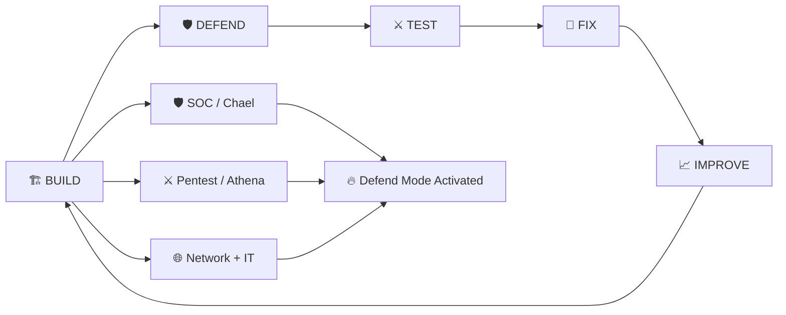
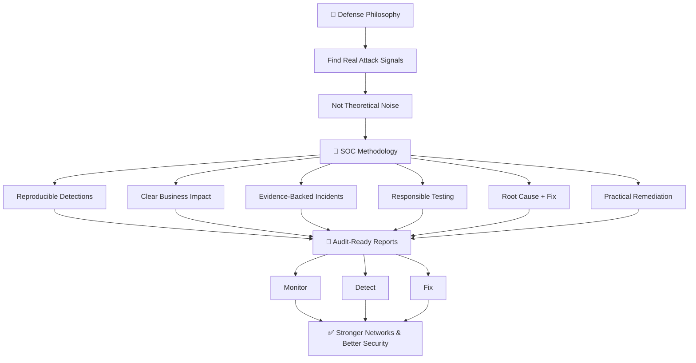
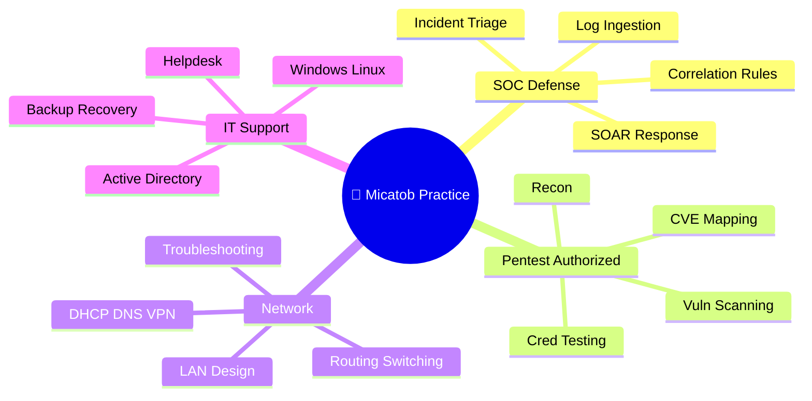
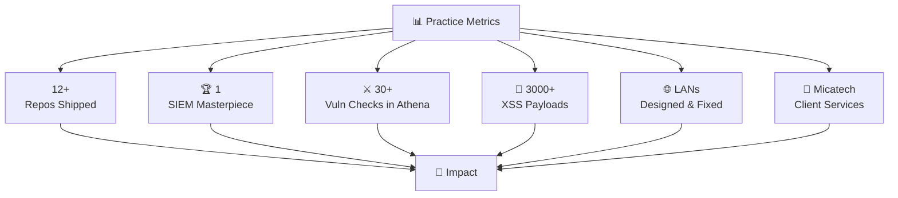
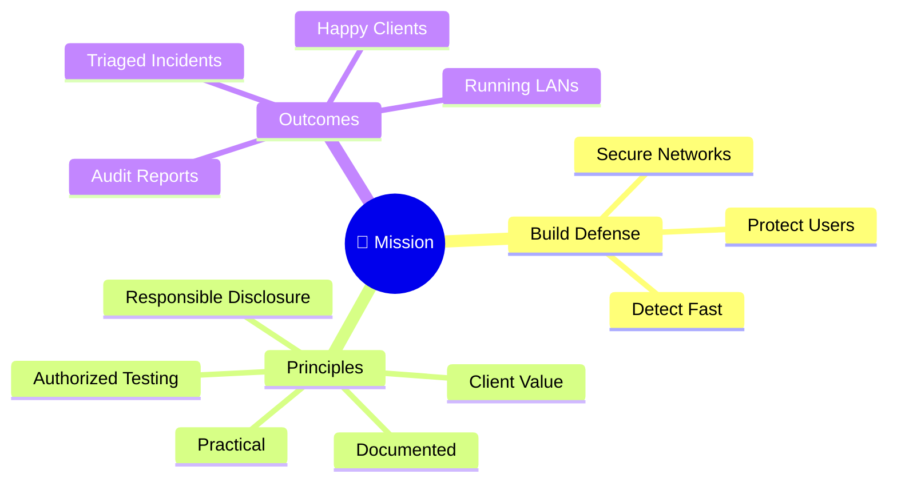

# Hi, I'm Michael Eromosele Ebibhazebhilo (Micato) 👋 — Micatob | Founder & CEO @ Micatech

[](https://github.com/Micatob)
[](https://github.com/Micatob?tab=followers)
[](https://x.com/Micatob)
[](https://www.tiktok.com/@micatoz)
[](https://youtube.com/@micatob)
[](https://hiresphere.com.ng)
[](https://micatech.vercel.app)

```bash
Micatob@github:~$ micato system-status

[✓] SOC Monitoring / Chael SIEM      :: ACTIVE
[✓] Penetration Testing / Athena     :: ACTIVE
[✓] Network Engineering              :: ACTIVE
[✓] IT Support & Administration      :: ACTIVE
[✓] Threat Detection                 :: RUNNING
[✓] Python Security Tooling          :: BUILDING
[✓] Micatech Client Services         :: OPEN
[✓] Micatech — Web • Cyber • IT • Networking :: RUNNING

$ micato mission

> Secure networks. Detect attacks fast.
> Test like an attacker. Fix like IT.
> Turn skills into production-grade defense.
> Serve clients through Micatech.

$ micato philosophy

BUILD > DEFEND > TEST > FIX > IMPROVE > REPEAT

$ micato ecosystem

SOC + PENTEST + NETWORK + IT
              ↓
           MICATECH

$ micato status

SYSTEMS:     EVOLVING
FOUNDATION:  ACTIVE
ECOSYSTEM:   BUILDING
MODE:        DEFEND 🔥

$ micato command

Build once.
Secure everywhere.
Evolve continuously.

Status: MICATECH — ACTIVE 🚀
```

## 👋 Hi, I'm Michael Eromosele Ebibhazebhilo (Micato) — Founder of Micatech

**Micatob • Network Engineer • SOC Analyst • Junior Penetration Tester • IT Support Specialist • CEO @ Micatech • Nigeria**

I'm **Michael Eromosele Ebibhazebhilo**, known as **Micato (@Micatob)** on GitHub, X, TikTok, and YouTube. I work at the intersection of defensive security, offensive testing, networking, and IT support.

Through **Micatech — my brand where I'm Founder & CEO** — I turn security and network skills into client-ready services. Micatech is Web • Cyber • IT • Networking in one shop: SOC monitoring with Chael SIEM, authorized pentests and audit reports with Athena, LAN design/install/troubleshooting, IT setup and managed support, plus lean landing pages. Clear scope, fast delivery, documentation, and support after deployment — via https://hiresphere.com.ng and https://micatech.vercel.app.

My work spans SOC monitoring with my own SIEM, authorized penetration testing with my own toolkit, LAN design and troubleshooting, Windows/Linux administration, and Python security tooling — with a focus on building things that are practical, documented, and designed to evolve.

As founder, my focus is not just on individual tools, but on an ecosystem where defense, testing, networks, and support compound into useful services for businesses and individuals.

Current focus: SOC analysis • Chael SIEM • Athena pentesting • Network engineering • IT support • Micatech delivery • Python tooling

## ⚙️ Current Operating Mode



## 🏆 Recognition

- Founder & CEO — **Micatech (Web • Cyber • IT • Networking)**
- GitHub Achievement: **Quickdraw**
- Builder of **CHAEL SIEM** — microservices SIEM masterpiece
- Builder of **Athena** — all-in-one penetration testing toolkit
- Open to: SOC roles, network contracts, authorized pentest audits, IT support contracts

## 🔬 Focus Areas

- SOC Monitoring (log collection, correlation rules, triage, incident lifecycle, SOAR)
- Defensive Security (Wireshark, OSINT, vulnerability scanning, Linux hardening, Sigma)
- Web Application Pentesting — authorized only (OWASP Top 10, SQLi/XSS/CMDi/LFI/SSRF, auth testing)
- Network Engineering (LAN design, TCP/IP, subnetting, Cisco-style routing & switching, DHCP/DNS, VPN, cabling)
- IT Support & Admin (Windows 10/11, Ubuntu/Kali, Active Directory, helpdesk, backup, printers, AnyDesk/RDP)
- SIEM Engineering (FastAPI, OpenSearch, Redis, Nginx, React, Docker, Prometheus, NetFlow)
- Python Security Tooling (asyncio/aiohttp scanners, enumeration, reporting)
- Micatech Delivery (scoping, fast delivery, documentation, post-deployment support)

## 🛠️ Tech Stack

**Languages & Scripting**

Python • HTML/CSS/JavaScript • Bash/PowerShell basics • Dart (basic apps)

**SOC / Defense**

Chael SIEM • SOC workflows • Log Analysis • Correlation Rules • Incident Triage • SOAR • Sigma • Threat Intel / IOC • Wireshark • OSINT

**Pentest / Offense (authorized only)**

Athena • Recon • Vuln Scanning • Bruteforce / Cred Stuffing • SMB/SNMP/SMTP Enum • CVE Mapping (CVSS) • Burp Suite basics • WAF Detection & Evasion

**Network & IT**

TCP/IP • Subnetting • LAN/WAN • Cisco IOS • Routing & Switching • DHCP/DNS • VPN • Wi-Fi/Cabling • Nmap • Windows/Linux • Active Directory • Helpdesk

**Build / Web / Tools**

FastAPI • OpenSearch/Redis/Docker/Nginx • React (dashboard) • Git & GitHub • Prometheus • AI-assisted development

> Core approach: Python for detection and testing, OpenSearch/Redis/Docker for SIEM runtime, TCP/IP + Cisco patterns for networks, and Micatech process for client delivery.

**Detection Stack**

Chael SIEM (ingest → correlate → incidents → SOAR) • Wireshark • Nmap • Sigma converter • Threat feed • ML Analytics (UEBA)

**Operating System**

Windows 10/11 • Ubuntu • Kali Linux


---

## 🔧 What I Build

- SIEM systems (log ingestion, correlation engine, incidents, SOAR playbooks, dashboards)
- Pentest automation (discovery → vuln scan → creds → enum → CVE → HTML/JSON/CSV/PDF)
- XSS / directory enumeration tooling (payload testing, brute-force + crawling + fuzzing)
- Network setups (small office/home/campus LANs that just work, documented)
- IT support systems (OS install, AD/users, file sharing, printers, backup, remote support)
- Python security utilities (async scanners, recon, reporting pipelines)
- Static landing pages for businesses (lean, fast, AI-assisted)
- Micatech client delivery (scope + timeline + quote + support after deployment)
- SOC hunting workflows (MITRE mapping, IOC enrichment, FP checklist, lessons-learned)
- IT + Network documentation (IP plans, configs, handover notes)

## 🚀 Core Projects

### 🏆 Masterpiece: SOC / Defense

**[chael — CHAEL SIEM](https://github.com/Micatob/chael) (Python FastAPI + OpenSearch + React + Docker)**

> My masterpiece. Modern containerized SIEM for real SOC work on small networks.

**What it is:** FastAPI + OpenSearch + Redis + Nginx gateway + React dashboard. Real-time log ingestion, correlation-based detection, incident lifecycle, and SOAR automation — all Docker-Compose up.

**Why it's my masterpiece:**
- Full SOC loop: `Agent → Gateway (:8001/:8443) → Ingest → Correlate → Incidents → SOAR → Dashboard (:3000)`
- Not a toy logger — JWT auth, agent registry, Redis counters, Prometheus (:9090), NetFlow (:2055/udp)
- Shows my core goal: defend systems with my own SIEM

Key: normalized `/ingest` + `/raw/{source}`, 5+ SSH fails/60s → MEDIUM (65), 15+ → HIGH (85), internal ranges whitelisted, fatigue control, MITRE + IOC investigate, SOAR trigger/approve, ML (UEBA), threat feed, Sigma converter, archiver, AI co-pilot (BYOK).

```bash
# masterpiece quickstart
.\deploy.ps1
# → http://localhost:3000 (admin / ADMIN_PASSWORD in .env)
```

See `AGENT_DEPLOYMENT.md`, `ROADMAP.md`, `HUNTING_ROADMAP.md` in the repo.

### ⚔️ Pentest / Security Research & Automation

**[Athena](https://github.com/Micatob/Athena) (Python asyncio) — All-in-one penetration testing toolkit**

Async Python 3 PTES framework: discovery → 30+ vuln checks (SQLi, XSS, CMDi, LFI, SSRF, SSTI, XXE, etc.) → credential testing (FTP/SSH/MySQL/Postgres/MSSQL/Redis/Telnet + form stuffing) → SMB/SNMP/SMTP enum → CVE mapping (CVSS) → HTML/JSON/CSV/PDF. 11-stage pipeline, safe-mode + auth gates, Tor/proxy, ~90 WAF fingerprints + bypass, AI correlation (Gemini/Groq/DeepSeek), REST API, post-exploit chain. Use responsibly — authorized targets only.

**[Xss-Scanner](https://github.com/Micatob/Xss-Scanner) (Python + AI)**

Reflected XSS payload tester (3000+ payloads) with built-in AI assistant support.

**[Deep-Directory](https://github.com/Micatob/Deep-Directory) (Python)**

Next-gen directory enumeration: brute-force + crawling + fuzzing. Forked and extended from LifeJiggy/Deep-Dir.

**[Email-osint](https://github.com/Micatob/Email-osint) (Python)**

Enumerate websites to find emails, numbers, names and other sensitive info for OSINT recon.

### 🌐 Network & IT Utilities

**[screenkonect](https://github.com/Micatob/screenkonect) (TypeScript)**

Consent-based remote desktop support — ScreenKonect for IT helpdesk.

**[Device-Monitor](https://github.com/Micatob/Device-Monitor) / [PDF-Lite](https://github.com/Micatob/PDF-Lite) (Dart/Flutter)**

Lightweight mobile utilities.

## 🏢 Micatech — My Brand (Founder & CEO)

**Micatech = Michael Eromosele Ebibhazebhilo's tech services brand.** I'm the CEO — I scope it, build it, secure it, and support it.

What Micatech delivers:
- 🛡️ SOC monitoring & hardening (defensive) — Chael SIEM deployment, log review, triage, SOAR response
- ⚔️ Authorized pentests & audit reports — Athena-driven recon → vuln scan → CVE → HTML/PDF report + fixes
- 🌐 LAN design, install & troubleshooting — planning, IP addressing, switch/router config, testing, docs
- 🧰 IT setup & managed support — Windows/Linux, AD/users, printers, file sharing, backup, remote helpdesk
- 🚀 Lean websites & landing pages — fast static sites for businesses

How I work: send scope + location + timeline via **https://hiresphere.com.ng** → I reply with plan + quote → build → test → document → support after. Portfolio & bookings: **https://micatech.vercel.app**.

> Micatech is why I build in public — every repo (Chael, Athena, scanners) makes client work faster and stronger.

## 🌍 Open Source Ecosystem (2026)

Building an ecosystem focused on:

- 🛡️ SOC Systems & Detection
- ⚔️ Authorized Pentest Automation
- 🌐 Network Engineering Reuse
- 🧰 IT Support Playbooks
- 🐍 Python Security Tooling
- 🚀 Micatech Client Delivery
- 📝 Documented, Runnable Systems
- 🔁 Continuous Improvement

## 📖 Defense Philosophy



## 🔬 Security Practice



## 📊 Practice Metrics



## 🎯 Mission



## 📈 Progress Timeline

### 🌱 Currently Working On

- Chael SIEM roadmap — detection rules, parsing, dashboards, threat intel keys, SMTP digests
- Athena hardening — payloads, WAF bypass, reporting polish, authorized lab testing
- SOC hunting workflows — MITRE mapping, IOC enrichment, FP reduction
- Micatech client work — LAN setups, hardening, IT support, landing pages
- Python tooling — ingest normalizers, correlation tuning, report generation
- Content — TikTok [@micatoz](https://www.tiktok.com/@micatoz) breakdowns of SOC / networking / IT fixes

### 🤝 Collaboration

Open to collaborating on:

- SOC detection (rules, parsing, dashboards, SOAR playbooks)
- Authorized pentest tooling (scanners, enumeration, reporting)
- Network + IT projects (LAN builds, troubleshooting, documentation)
- Python security utilities (CLI tooling, automation, reporting)
- Micatech client gigs with clear scope + timeline


## 📫 Connect — Michael Eromosele Ebibhazebhilo (Micatob)

- 🌍 Website / Hire me: **https://hiresphere.com.ng**
- 🌐 Micatech App: **https://micatech.vercel.app**
- ✖️ X (Twitter): **[@Micatob](https://x.com/Micatob)**
- 🎵 TikTok: **[@micatoz](https://www.tiktok.com/@micatoz)**
- ▶️ YouTube: **[@micatob](https://youtube.com/@micatob)**
- 💼 Company: **Micatech — Web • Cyber • IT • Networking — Founder & CEO: Michael Eromosele Ebibhazebhilo**
- 📍 Location: Nigeria (open to remote & on-site)
- GitHub: **[@Micatob](https://github.com/Micatob)** — Micatob

**⭐ Open to SOC roles, network contracts, authorized pentests, IT support, and Micatech projects.**

## From Curiosity to Systems

What started with curiosity, persistence, and a willingness to learn has evolved into building, breaking, fixing, and securing real systems.

The path has included failed configs, noisy logs, false positives, tough troubleshooting, merge conflicts, and countless moments where stopping would have been easier.

I kept building.

That persistence turned into LANs that work, a SIEM masterpiece, a pentest toolkit, Python utilities, and Micatech — a vehicle to serve clients.

Today as **Founder & CEO of Micatech**, I'm building services around defense, testing, networks, and IT.

The goal is simple:

> Secure networks, detect fast, test honestly, fix completely — and leave every system better than I found it.

I believe the strongest security is not installed once and forgotten. It evolves. Every log can become a detection. Every test can become hardening. Every ticket can become documentation. And every client system can become a reference.

## What I'm Building Toward 🚀

Micatech is being built around a long-term vision:

**SOC + Pentest + Networking + IT = reusable security services.**

I'm continuing to build, defend, test, document, and deliver — one system at a time.

The foundation is active now. The ecosystem comes next.

⭐ If you're securing infrastructure and believe in practical defense, you're welcome to build with us.

## ⚔️ 🛡️ Defend Mode Activated

Learning. Building. Defending. Testing. Fixing. Evolving.

🚀 The mission remains: create value, solve hard problems, secure systems that matter.

Build the LAN. Tune the SIEM. Test the holes. Fix the system. Share the knowledge. Grow Micatech.

— **Michael Eromosele Ebibhazebhilo (Micatob) | Founder & CEO, Micatech**

---

<!-- SEO: Michael Eromosele Ebibhazebhilo, Micato, Micatob, Micatob GitHub, Michael Ebibhazebhilo Nigeria, Founder Micatech, CEO Micatech, Micatech Web Cyber IT Networking, Network Engineer Nigeria, LAN Setup Cisco TCP/IP, SOC Analyst Nigeria, Chael SIEM, Defensive Security Blue Team, Penetration Tester Athena PTES, IT Support Specialist Active Directory Windows Linux, Python Security Tools, OSINT, TikTok micatoz, YouTube micatob, X Micatob -->
